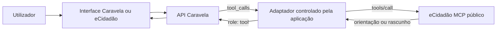

# Caravela × eCidadão: integração e colaboração

Verificado em 27/11/2026. Produto analisado: **Caravela Chat, caravela.chat**, apresentado pela equipa de Tiago Ferreira, João Amaro e Bartolomeu Rodrigues. Não confundir com a biblioteca Elixir Caravela encontrada em pesquisas por MCP. Pesquisa de páginas públicas; não houve login, contacto comercial, criação de conta ou chamadas pagas à Caravela.

## O que oferecem

A Caravela apresenta chat e modo Trabalho para organizações, pesquisa em documentos privados, skills, automações e integrações empresariais. O catálogo inclui Google Workspace, Microsoft 365, faturação/ERP e fontes portuguesas como INE, Portal BASE, BEP, Diário da República e gov.pt. Algumas ligações são configuráveis no produto; outras aparecem como integração por reunião. Não interpretar todo o catálogo como ligações já disponíveis para qualquer conta. [Integrações](https://caravela.chat/integracoes)

Há uma oferta dirigida a juntas, câmaras e organismos, com documentos, atas, relatórios e gestão de ocorrências. A página descreve integração por APIs, bases de dados ou exportações. É um possível canal de distribuição/parceria para eCidadão, além de fornecedor de modelos. [Organizações públicas](https://caravela.chat/organizacoes-publicas)

## Como ligar

**Via API, há um caminho documentado.** A API suporta Chat Completions, incluindo funções executadas pelo cliente. Base: `https://api.caravela.chat/api/v1`, autenticação Bearer. O cliente recebe `tool_calls`, executa as funções e devolve mensagens `role: tool`. Não se podem misturar ferramentas `custom` e `function` na mesma lista. Com funções do cliente, a documentação indica que as ferramentas internas também podem estar ativas. Não encontrei uma configuração pública para adicionar um URL MCP diretamente ao chat. [Documentação](https://caravela.chat/api/docs)

Arquitetura proposta:

O adaptador deve converter os schemas MCP, manter uma lista explícita de ferramentas permitidas e preservar resultados/erros. Prefixar os nomes com `ecidadao__` evita colisões. Não deve executar URLs, comandos ou nomes arbitrários propostos pelo modelo. No primeiro piloto, expor apenas orientação SNS 24; limitar rondas e terminar sem novas ferramentas após receber o resultado. O controlo de ferramentas internas da Caravela deve ser validado antes de alargar o âmbito.

Foram preparados [pedido de exemplo e resultado real do MCP](../examples/caravela/README.md). Confirmei sete ferramentas públicas e uma chamada SNS 24 real, sem dados pessoais. **A chamada à Caravela não foi executada**: falta token, faturação e validação do comportamento do fornecedor. Isto demonstra a preparação da ponte, não compatibilidade E2E certificada.

## Duas integrações diferentes

| Opção | Valor | O que falta |
|---|---|---|
| eCidadão dentro do chat Caravela | Os clientes deles usam os nossos percursos e rascunhos | Acordar integração nativa ou suporte MCP; não basta instalar o ZIP Codex/Claude |
| Caravela como fornecedor de conversação no eCidadão | Interface conversacional sobre ferramentas já existentes | Adaptador, token, limites de custo, testes e decisão sobre tratamento de dados |
| Parceria com uma autarquia | Ligar o pedido do cidadão ao processamento pela entidade | Contrato de receção, isolamento por entidade, estados, notificações e comprovativo |

**Recomendação:** começar pela primeira opção, com uma demonstração SNS 24 e administrativa. Oferecemos funcionalidades concretas sem reconstruir a plataforma de chat. A segunda opção faz sentido se quisermos acrescentar conversação ao site, mas introduz operação e custo recorrentes.

## Onde podemos ajudar e estender

1. **Percursos executáveis e limites claros:** a pesquisa gov.pt que já anunciam sobrepõe-se à nossa descoberta. O diferencial a demonstrar é uma saída estruturada: requisitos, próximo passo, fonte, revisão e estado real do pedido.
2. **SNS 24:** quatro percursos PT/EN já disponíveis no nosso MCP. Não encontrei prova, nas páginas consultadas, de uma integração Caravela de marcações SNS/IRN. Nem a nossa ponte nem a pesquisa deles concedem esse acesso.
3. **Autarquias e ocorrências:** eles já anunciam receção com foto/localização e gestão de estado. Podemos propor uma ponte para cidadãos e assistentes externos, com comprovativo e acompanhamento, se disponibilizarem API/webhooks. Não duplicar o gestor deles; começar por confirmar se aceitam integração. A nossa ferramenta pública atual só prepara rascunhos A Minha Rua.
4. **Qualidade de português e de processos:** oferecer um conjunto de avaliações de seleção de ferramenta, PT/EN, campos inválidos, falhas e falsas confirmações. Um serviço não deve passar de rascunho a submetido porque o modelo o afirmou.
5. **Distribuição interoperável:** conservar os contratos públicos MCP independentes do fornecedor de modelos, para os mesmos percursos funcionarem em vários assistentes.

Em sentido inverso, as fontes e documentos empresariais da Caravela podem enriquecer descoberta e preparação no eCidadão. Antes de usar respostas geradas como dados de catálogo, validar fonte, atualidade, atribuição e condições de reutilização.

## Piloto proposto

Três pedidos sem dados pessoais: explicar exames na app SNS 24; orientar marcação SIGA; preparar uma questão genérica para e-balcão. Validar seleção de ferramenta, argumentos e links, erro explícito e ausência de alegações de submissão. Segundo passo: demonstração de uma ocorrência para entidade parceira, apenas depois de existir interface autorizada de receção.

Critério de sucesso: resposta correta e verificável, com fontes, sem executar ferramentas não previstas; custo e latência medidos. Não contar como sucesso uma resposta plausível sem a chamada esperada. Uma demonstração de marcação real permanece dependente de acesso aos operadores públicos.

## Custos e dados a esclarecer

A página API anuncia utilização por tokens e cobrança por chamadas a integrações. É necessário esclarecer se funções externas e rondas internas entram nessa cobrança e qual o limite efetivo por tarefa; não estimar custo por uma única resposta visível. [API e preços](https://caravela.chat/api)

A política distingue histórico do chat, documentos guardados e conteúdo API. Também descreve telemetria com conteúdo no plano gratuito, enquanto a página API anuncia retenção zero. É uma discrepância de âmbito a esclarecer para o plano contratado, não uma verificação do comportamento real. Para dados pessoais, confirmar retenção, logs, ferramentas externas e subprocessadores por escrito. O piloto proposto não precisa de informação pessoal ou clínica. [Política de privacidade](https://caravela.chat/privacy-policy)

## Questões para a equipa

- Aceitam MCP remoto Streamable HTTP no chat, ou preferem funções/API geridas por vocês?
- Podemos publicar uma integração eCidadão no vosso catálogo? Como funcionam revisão, versões e distribuição?
- Como desativar/restringir ferramentas internas quando fornecemos funções externas? Há rastreio das chamadas e limite de custo por execução?
- A gestão de ocorrências tem API/webhooks, comprovativos, anexos e isolamento por organização?
- Que SLA, sandbox, condições de API e regime de dados se aplicam a este piloto?
- Há interesse num piloto com uma junta/câmara e num conjunto partilhado de testes PT-PT?

Contacto público: `info@userquest.io`, indicado na [página de contactos](https://caravela.chat/contactos). **Nenhuma mensagem foi enviada.**
